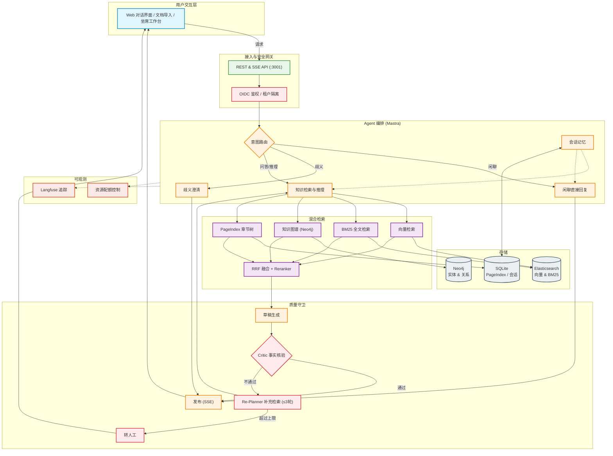

# NexusRAG

Agentic RAG 知识助手：Mastra 编排 + 向量/BM25/知识图谱/PageIndex 混合检索。

---

## 架构设计



---

## 本地启动（按顺序）

> 前置条件：Node.js ≥ 20、Docker（用于基础设施）。以下命令均在仓库根目录执行。

### 1. 基础设施（Elasticsearch + Neo4j）

```bash
docker compose -f docker-compose.op-stack.yml up -d elasticsearch neo4j
```

本机 9200/7687 往往被其他服务占用，这套 compose 把 ES 发布在 **:9201**、
Neo4j 发布在 **:17687**（见 compose 文件注释）。健康检查通过后再继续。

### 2. 环境检查

```bash
cp .env.example .env   # 首次运行；随后填入各凭据槽
```

必需：`OPENAI_API_KEY`、`EMBEDDING_API_KEY` 及各自 BASE_URL/MODEL；并把
`ES_NODE=http://localhost:9201`、`NEO4J_URI=bolt://localhost:17687` 指向
上一步发布的端口（否则后端会连到本机其他栈）。
可选：`RERANK_API_KEY`（专用重排）、`TAVILY_API_KEY`（网络证据）、
`LANGFUSE_PUBLIC_KEY`/`LANGFUSE_SECRET_KEY`（追踪导出）、
`DEMO_OIDC=1`（三账号本地身份演示）。

### 3. 后端

```bash
npm install
npm run build
npm run dev          # 监听 :3001
```

### 4. 前端

```bash
npm run dev:web      # Vite 监听 :3000（/api 代理到 :3001）
```

### 5. 状态页

直接访问 `GET /api/status`。
状态覆盖 Elasticsearch、Neo4j、Chat、Embedding、Rerank、文档解析器、
MCP、网络搜索与 Langfuse；**未配置的可选项显示「未配置」——不是失败，
也不是成功**。诊断信息只包含主机名，永不包含凭据或完整 URL。

### 6. 日志

stdout 仍是单行 JSON；默认还会在 `LOG_DIR`（默认 `logs/`）写两个按天轮转的
WeKnora 文本文件：`system-YYYY-MM-DD.log`（与 stdout 同源，并吸收 `console.*`）
与 `agent-YYYY-MM-DD.log`（Answer run 执行元数据，不含问题/回答正文与 token）。
保留最近 7 个自然日（含当日）。

回退：`LOG_FILE=off` 只保留 stdout 且不创建任何文件；`LOG_LEVEL=off` 把
stdout 与两个文件一并静音。完整变量说明见 `.env.example`。

已知限制：进程被强杀或断电时，最后仍在缓冲区中的少量记录可能丢失；
日志目录永久不可写时，文件分支在首次诊断后静默降级，stdout 不受影响。
与 WeKnora 规范的接受偏离：stdout 仍是 JSON 而文件为文本（两者内容不
一致），且不提供 `LOG_FORMAT` 模板、ANSI 着色、按大小轮转与 LLM 调试文件。

### 演示数据

```bash
npm run demo:seed         # 播种确定性演示命名空间（幂等）
npm run demo:reset        # 预览重置；加 -- --confirm 执行并重新播种
```

---

NexusRAG 是一个非商业的本地演示项目：所有演示政策文档均为明确标注的
虚构内容，仅用于检索、隔离与拒答能力演示。

