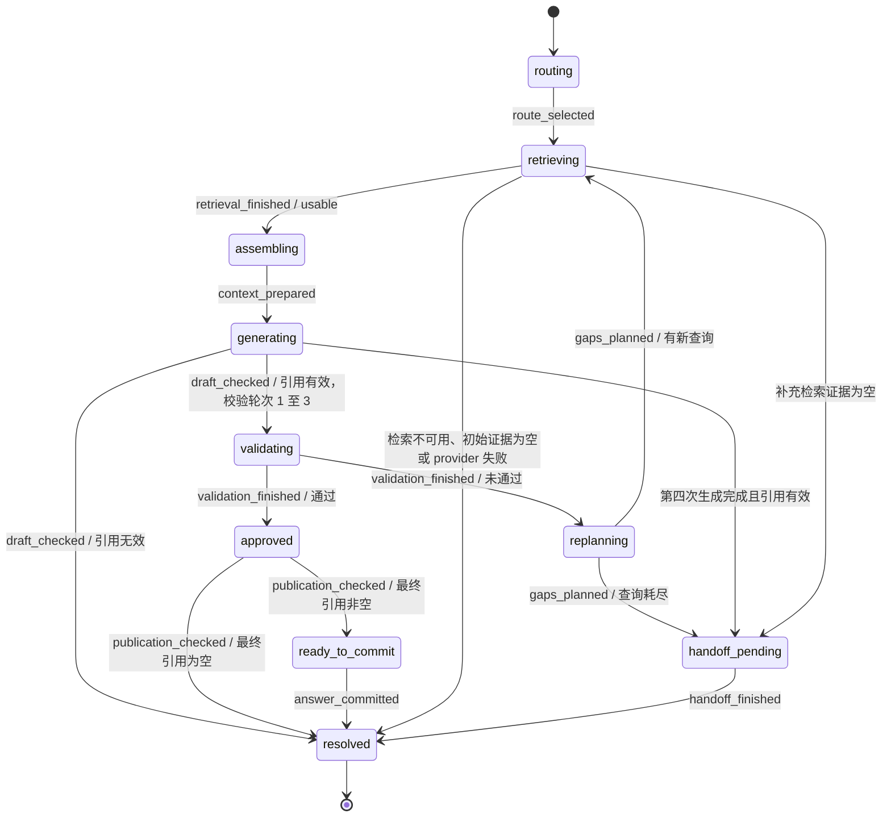
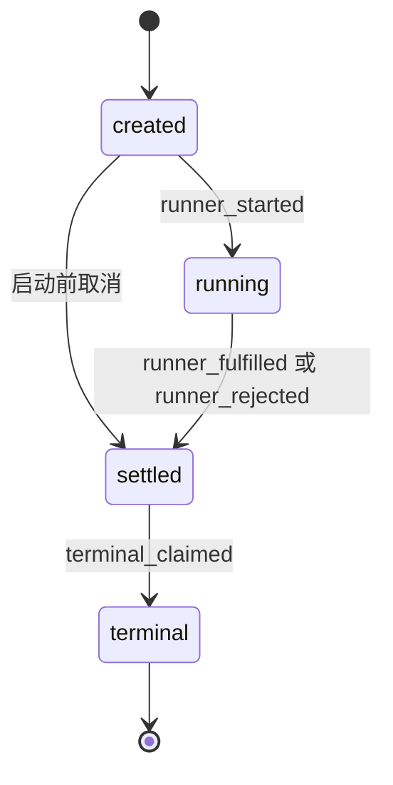

# RAG 执行状态机

知识回答的控制流程由 `src/mastra/answer_run_state.ts` 定义。简单问答与复杂问答各自创建一个知识回答状态机。事件适配器创建另一个交付状态机，负责记录运行结果并发布终态。

`route_dispatch_runner.ts` 仍负责选择路由。FAQ、直接回复和澄清沿用各自执行路径。知识状态机只接收已经选定的 `simple` 或 `complex` 路由。

## 知识回答的状态流

`advance` 只接受当前状态允许的观察结果。非法跳转返回 `rejected`，保留原状态对象。调用者必须检查这个结果。

简单与复杂问答使用同一组状态。复杂问答中的工具循环继续负责自己的检索策略、预算和回退。知识状态机观察该次检索的结果。

## 校验、生成和保存的边界

最多执行三次校验。第三次校验未通过后，如果重规划还有新查询，现有流程仍可补充检索并生成第四份草稿。第四份草稿不再进入校验。引用有效时转入人工交接判断，引用无效时返回 `invalid_citation`。

`approved` 保存通过校验的那份草稿。最终引用检查通过后，`ready_to_commit` 才提供可保存的回答。写入已验证会话后，`answer_committed` 将状态推进到完成。缺失或无效的可选 `answerBasis` 沿用现有绑定规则，不会单独阻止回答完成。

未通过校验的草稿不发布草稿 token、引用或已验证会话。初始证据不足时，runner 仍保留原有安全提示文本及其 token 约定。

第四次生成的实际上下文快照与最终接受的引用上下文是两个记录。只有引用检查通过的草稿才能更新 `finalContextCandidates`。第四份草稿引用无效时，接受的上下文仍来自先前一轮。

## 交付状态机与事件

第一次结算决定交付结果。runner 成功返回后，传输层晚到的取消信号不会将回答改成取消。`terminal_claimed` 只能成功一次，并在通知终态事件的硬性 trace observer 之前占用终态。

取消和 provider 异常由交付边界处理。硬性 trace observer 失败及 `RouteNotSupportedError` 继续抛出，不伪造 `done` 事件。

`progress` 是观测信息。它不会推动控制状态。适配器可以在末尾补发路由、检索、上下文和校验的汇总信息，因此事件中的阶段和轮次不保证单调前进。既有检索事件轮次序列 `[1, 2, 1]` 仍然有效。

## 其他业务状态机

| 流程 | 状态拥有者 | 约束 |
| --- | --- | --- |
| 摄取与来源退役 | `IngestionLifecycle`、`TaskRepo`、`DocumentRepo` | 退役来源不再开始新阶段或激活版本。仍在运行的摄取退出后才执行退役清理。 |
| 数据源同步 | `SyncRunService`、`SyncDataSourceService` | 恢复任务撤销旧认领。晚到的旧响应不能提交文档、修改来源台账或覆盖新结果。 |
| 会话附件 | `SqliteSessionAttachmentStore.completeParsing` | 仅从 `parsing` 原子提交正文、分块和 `ready`。删除后的晚到解析不再写入。 |
| PDF 流 | `DocReaderPdfParser.parseRaw` | `awaiting_metadata` 后接收指定数量的图片，再进入 `awaiting_end`。超额图片在处理前拒绝。 |
| Wiki | `WikiStore`、`WikiEngine` | 已有页面状态和任务状态。任务恢复只在 worker 启动时执行，物化前复查来源退役及活动版本。 |
| FAQ | `FaqEntryRepo` | 已有启用状态、不可变版本和事务性活动指针。 |
| 人工交接 | `SqliteHandoffStore` | 已有显式合法转换表及终态检查。 |
| 身份与上传队列 | 前端领域模型及摄取入口 | 已有命名状态。普通加载标记不属于本次业务状态机改造。 |

摄取退役验证覆盖运行中的摄取与退役清理交错。它不覆盖“取消或过期回收已经撤销任务身份，但外部非合作写入仍未结束”的组合场景，也不证明外部存储具备事务性。

## 验证入口

`src/mastra/answer_run_state.test.ts` 检查非法跳转、批准后的发布边界、最后一次生成和唯一交付终态。两个知识 runner 与事件适配器的现有测试覆盖实际调用、会话保存和事件行为。

`src/attachments/session_attachment.test.ts`、`src/sync/sync_run_service.test.ts`、`src/ingestion/executor_fencing.test.ts` 和 `src/ingestion/parser/docreader_pdf.test.ts` 保留确定性的业务回归。

摄取退役的模型和真实代码探针位于 `.agents/skills/verify-ingestion-retirement/`。该目录的 `SKILL.md` 说明模型边界、同步代码版本和破坏变体验证。模型通过只证明列出的边界。
