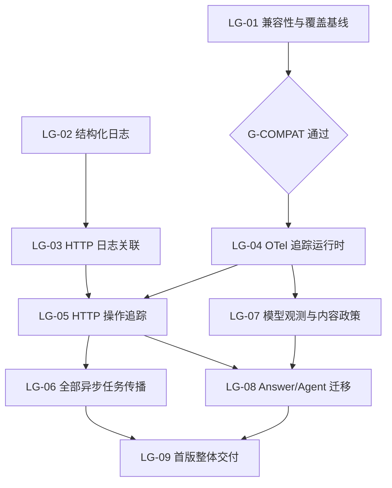

# 日志与 OTel 追踪：9 项本地规格

Updated: 2026-10-20T10:44:25.286Z  
Tracker: local  
Status: published  
Label: ready-for-agent  
Implementation: not_started

本目录是此次日志/OTel 首版的唯一规格与执行导航。用户已确认职责边界和测试边界；本次仅发布规格，不开始实现。总需求见[总规格](spec.md)，依赖、门槛、状态及覆盖映射见[机器计划](plan.json)。

## 拆分清单

| 编号 | 交付 | 阶段 | 直接技术前置 |
|---|---|---|---|
| LG-01 | [验证 OTel 到现有 Langfuse 的兼容性并冻结覆盖基线](issues/lg-01-compatibility-and-coverage-baseline.md) | 前置验证 | 无 |
| LG-02 | [交付解耦的结构化运行日志与 stdout 背压](issues/lg-02-structured-stdout-logging.md) | 阶段 1 | 无 |
| LG-03 | [关联 HTTP 请求并记录一次可靠终态日志](issues/lg-03-http-request-logging.md) | 阶段 1 | LG-02 |
| LG-04 | [交付中性契约背后的 OTel 追踪运行时](issues/lg-04-otel-tracing-runtime.md) | 阶段 2 | LG-01 |
| LG-05 | [在真实 HTTP 操作白名单建立追踪与采样上下文](issues/lg-05-http-operation-tracing.md) | 阶段 2 | LG-03、LG-04 |
| LG-06 | [贯通全部现有异步任务的追踪关联与恢复](issues/lg-06-async-task-context-propagation.md) | 阶段 2 | LG-05 |
| LG-07 | [观测全部现有模型入口并落实内容、usage 与 TTFT 策略](issues/lg-07-model-observation-and-content-policy.md) | 阶段 3 | LG-04 |
| LG-08 | [迁移 Answer / Agent 到真实操作与模型追踪，保持 SQLite 产品轨迹](issues/lg-08-answer-agent-trace-migration.md) | 阶段 3 | LG-05、LG-07 |
| LG-09 | [验收三条解耦链路并交付可回退的首版](issues/lg-09-integrated-acceptance-and-rollout.md) | 首版交付 | LG-06、LG-08 |

## 依赖与建议顺序



建议顺序：**LG-01 → LG-02 → LG-03 → LG-04 → LG-05 → LG-06 → LG-07 → LG-08 → LG-09**。这是阅读/实施建议，只有表中依赖及 G-COMPAT 是技术门槛。初始无依赖前沿是 LG-01、LG-02；LG-01 不通过不会阻止 LG-02/03 的日志独立交付。图上的可独立工作不代表自动并行修改共享组合根或启动子代理。

**G-COMPAT 当前 not_run。** 调查报告完成与出口可实施是不同状态；报告发现不兼容时保持门槛 blocked，不能仅把 LG-01 标记完成就启动 LG-04。后端升级不在本次默认授权内。

阶段 1 = LG-02/03；阶段 2 = LG-04/05/06；阶段 3 = LG-07/08；LG-01 为前置验证，LG-09 为最终全链路验收。LG-07 技术上只依赖 LG-04，可提前准备与独立验证，完整首版仍需所有任务覆盖。

## 已确认测试边界

- 主要边界：真实 HTTP SSE/JSON、现有任务执行入口、真实隔离 SQLite；模型/外部来源通过可重放夹具控制。
- 必要补充：stdout 背压/写错、OTel 导出故障/关闭，以及合成 Langfuse 兼容性读回。
- 好的测试断言真实业务输入输出、状态、关联与持久化；不写 SDK 内部实现断言，不让裸 mock 替代真实 runner。
- 前端浏览器视觉、生产发布与真实模型质量未纳入本轮规格交付。

## 覆盖与完成状态

共有 **9 项规格、90 条用户故事、95 项具名验收、18 项边界决策**。所有验收初始未勾选，所有实施初始 not_started；ready-for-agent 仅表示已 triage。

实现时先发现最小相关测试命令，按各规格范围验收；完整首版执行项目已存在检查：

```powershell
npm test
npm run build
npm run typecheck:web
npm run build:web
```

按实际变更发现并运行现有架构/休眠表面契约与必要检查。新增回归阻止完成；预存失败和外部阻塞保留证据，不宣称全绿。当前只验证规格模板、依赖 DAG、覆盖映射与链接，不运行实现验收。

## 资料

- [用户已确认边界](../../.scratch/logging-system-plan-2026-10-20/boundaries.md)
- [当前实施流程图](../../.archify/workflow-logging-system-otel-20261020-181739/logging-system-otel.html)
- [现状与测试先例](source-map.md)
- [发布校验](validation.json)

本轮无外部 tracker 同步、依赖安装、业务源码修改、后端升级、TypeSafe 重评或生产发布。
