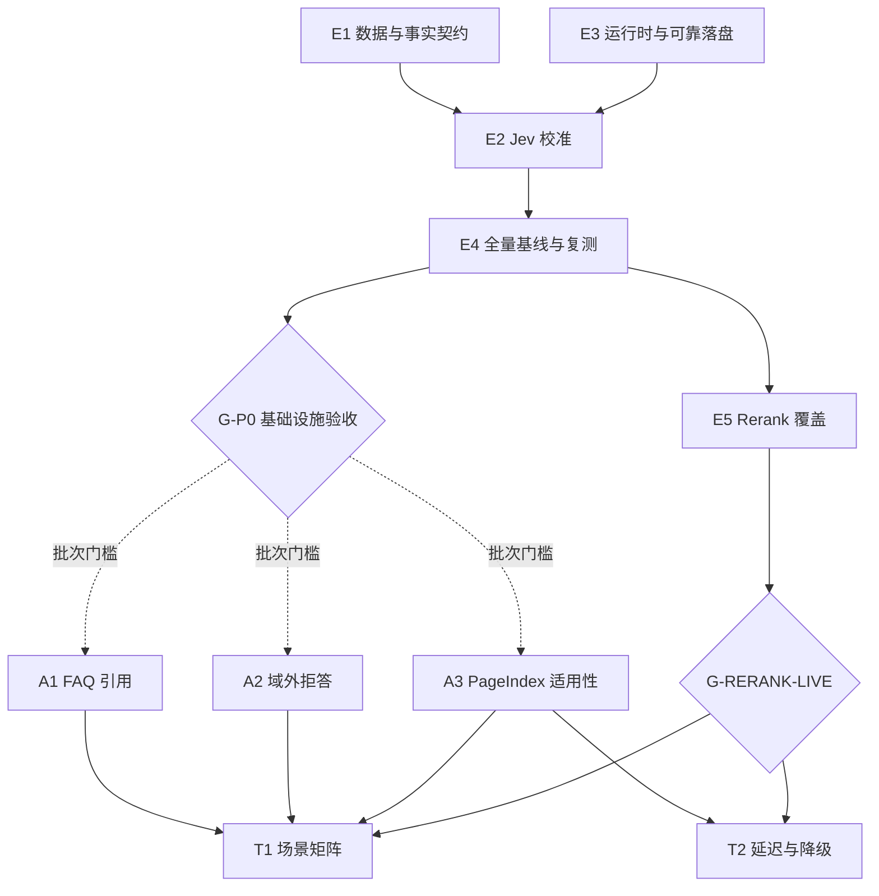

# DeepEval 可信评测与 Agent 修复：10 项本地规格

Updated: 2026-10-22T03:42:55.191+08:00  
Tracker: local  
Label: ready-for-agent  
Status: published  
Implementation: not_started

本目录是本次修复的唯一规格与执行导航。已按 to-spec 发布，测试边界已由用户确认；本轮不开始实现。总需求见[总规格](spec.md)，技术依赖、门槛、状态和完整覆盖见[机器计划](plan.json)。

## 拆分清单

| 编号 | 交付 | 批次 | 直接技术前置 | 批次/在线门槛 |
|---|---|---|---|---|
| E1 | [修复版本化数据转换与确定性答案契约](issues/e1-dataset-and-fact-contracts.md) | P0 | 无 | 无 |
| E2 | [校准 Jev 标准答案判断与指标适用范围](issues/e2-jev-calibration-and-applicability.md) | P0 | E1、E3 | 无 |
| E3 | [交付隔离评测运行时、单层重试与可靠落盘](issues/e3-runtime-retries-and-persistence.md) | P0 | 无 | 无 |
| E4 | [建立全量基线、重复采样与完整结果报告](issues/e4-repeated-baseline-and-honest-reporting.md) | P0 | E2 | 无 |
| A1 | [让 FAQ 快路径提供可解析行内引用](issues/a1-faq-inline-citation.md) | P1 | 无 | G-P0 |
| A2 | [区分清晰域外问题与真正需要澄清的问题](issues/a2-clear-out-of-domain-routing.md) | P1 | 无 | G-P0 |
| A3 | [在执行前限制 PageIndex 的适用意图](issues/a3-pageindex-applicability.md) | P1 | 无 | G-P0 |
| E5 | [用真实调用与排序证明 Rerank 覆盖](issues/e5-rerank-capability-coverage.md) | P1 | E4 | G-P0 |
| T1 | [扩展多轮、流式、并发与权限工具场景](issues/t1-behavior-and-isolation-matrix.md) | P2 | A1、A2、A3、E5 | G-P0、G-RERANK-LIVE |
| T2 | [加入可复算的延迟与降级状态验收](issues/t2-latency-and-degradation-gates.md) | P2 | A3、E5 | G-P0、G-RERANK-LIVE |

## 顺序与独立交付

建议顺序：**E1 → E3 → E2 → E4 → A1 → A2 → A3 → E5 → T1 → T2**。技术依赖与批次门槛分别记录，不因建议顺序制造无效依赖。E2 的真实校准需要 E1 标准与 E3 环境；E4 传递依赖两者。T2 不依赖 T1，可独立交付。

技术上无前置的是 E1/E3/A1/A2/A3；遵循先评测后产品的批次安排，后续获得实施指令后的初始可领取前沿为 **E1、E3**。该可独立关系不自动授权并行代理或并行修改共享文件。



**G-P0 当前 not_run。** E1–E4 要证明标准、校准、错误/落盘和真实采样台账可信；不要求尚未修复的 FAQ/路由等产品用例全部通过，避免 P0 与 P1 循环阻塞。实际产品失败必须如实报告。

**G-RERANK-LIVE 当前 not_run。** 需要真实 provider 调用、模型/排序一致且无重排降级；缺 key、未执行或只有离线结果均不能解锁相关完整在线验收。

P0：可信评测基础设施可独立使用；P1：各产品修复保持应用可用；P2：补充场景/性能门禁，不要求 P2 全部落地才承认 P0/P1 已验收部分。规格/实现/在线门槛状态始终分开。

## 已确认测试边界

用户确认：“沿用这些测试边界（推荐）”。

- 已获用户确认：真实 HTTP（JSON/SSE）和评测命令为主边界，使用隔离 SQLite；外部服务可重放，事实、统计、重试和文件锁仅作必要局部补充。

- 真实 Jev 校准、Rerank 正向覆盖和延迟实测独立保留在线验收；缺凭据、服务不可用、未测或缺记录不计通过。
- 好测试核对调用者可见输入输出、引用可解析性、终态、持久化和故障，不断言 SDK 私有结构或与产品无关的内部组织。

## 覆盖与状态

共 **10 项规格、100 条用户故事、100 项具名验收、18 项决策**。全部验收未勾选、实施 not_started。原始来源及当前测试先例见[来源映射](source-map.md)。

记忆规则保持：允许本人主动查看；记忆不作为知识引用；关闭记忆或跨 owner/tenant 不读。全面正文禁披露未纳入。

v1 和历史结果保留，新版契约显式版本化；case-10 答案正确性与 Rerank 执行覆盖分开。0.5 是原 Jev 阈值，0.7 只用于复测触发，不能为了通过降标。

## 后续实施验证

按各规格从现有脚本/测试发现最小可靠命令，先复现再修复。当前可复用项目检查如下，发布规格不运行这些业务检查：

```powershell
npm test
npm run build
npm run typecheck:web
npm run build:web
npm run release:quality-gate
```

在线 Jev、Rerank 与固定负载延迟需要实际可用栈和现有凭据；外部不可用是 error/未验证，不能变成 pass。正式性能为完整二十条预热后一百次测量，非 FAQ 知识回答至少七十次，nearest-rank p95 ≤30s；并发三独立列示。

## 发布记录

- [静态发布校验](validation.json)
- [发布元数据](publication.json)
- [原始修复计划](../../.scratch/deepeval-repair-plan-20261022/plan.md)

原计划和原始评测报告仅供来源追溯，不是第二执行队列。本轮无外部 issue 同步、代码/数据集/配置修改、依赖安装、服务启动、模型调用、提交推送或生产部署。

